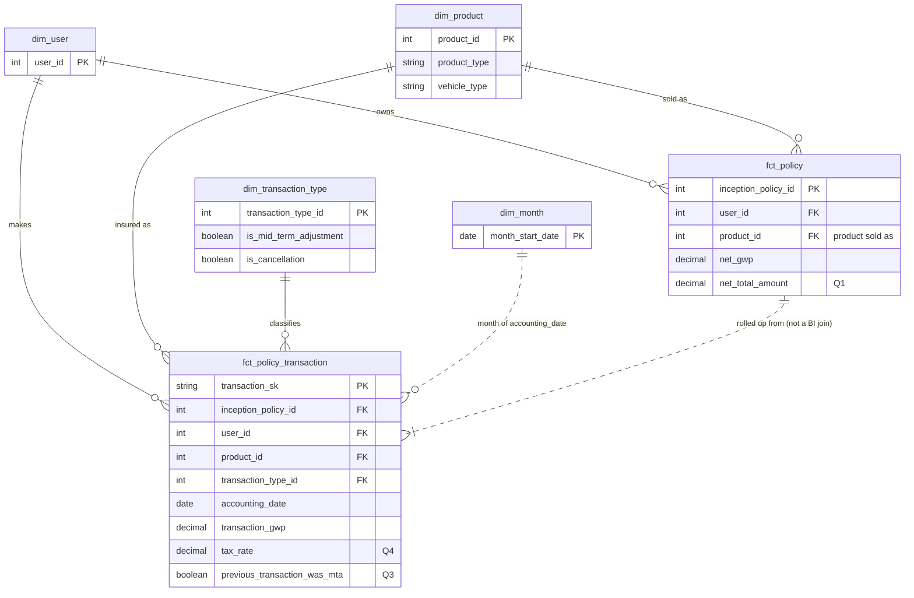

# Zego Analytics Engineering – Take-Home Task

A dbt project (DuckDB) that models the policy transaction data into a star schema a BI
user can answer all four Part 1 questions from. It runs on hand-built sample data
covering every edge case in the data dictionary; the expected answer to each question
was calculated by hand before any SQL was written, and the model reproduces all of
them. Assumptions are listed at the end.

## How to run

Requires Python 3.10+. DuckDB needs no account or credentials. Tested with dbt-core 1.12

```bash
cd ..
git clone https://github.com/Khalid-Ghzaoui/zego_ae_task.git zego-check
cd zego-check 
python -m venv .venv
.venv\Scripts\activate # Windows  (macOS/Linux: source .venv/bin/activate)
pip install dbt-duckdb
dbt deps  --profiles-dir .
dbt build --profiles-dir . # sample data, 10 models, 40 tests
dbt show --select q1_fixed_policy_users --profiles-dir . # likewise q2 (--limit 100), q3, q4
```

`seeds/` holds sample data · `models/staging/` one cleaned model per source ·
`models/marts/` the star schema · `analyses/` the Q1–Q4 SQL · `tests/` reconciliation test.

---

## Part 1 – SQL & Data Modelling

### 1.1 SQL queries

**Q1. Users who purchased at least one fixed policy with total transaction value > 0**
`analyses/q1_fixed_policy_users.sql`
Each policy's transactions are summed first (`fct_policy.net_total_amount`, premium +
tax net of refunds), then users with a fixed policy above zero are counted. A policy
bought and fully refunded correctly doesn't count. (A7, A8)
**Result on sample data: 3** ✅ (expected 3)

**Q2. Monthly GWP for 2025 to date by vehicle type, missing months as zero**
`analyses/q2_monthly_gwp_by_vehicle.sql`
Every month × vehicle combination is generated first (`dim_month` × vehicle types), then
GWP is attached, so empty combinations show 0 instead of disappearing. Refunds are
booked in the month of cancellation, and GWP follows the vehicle insured at the time.
(A6, A9, A10)
**Result: 88 rows** (22 months × 4 vehicles) ✅. Non-zero months match the hand
calculation: car Jan-25 495, Apr 50, Sep 550, Jan-26 480; van Feb-25 600, Mar −600,
Nov −20, Dec −100; scooter May 90, Jun 27.50.

**Q3. Flag whether the previous transaction on the policy was a mid-term adjustment**
Column `previous_transaction_was_mta` on `fct_policy_transaction`
(`analyses/q3_previous_transaction_was_mta.sql`). `LAG()` over each policy, ordered by
`change_number`, not by date: a cancellation keeps the policy's original start date,
so date ordering would misplace it. The first transaction is false. (A1, A3)
**Result: true only on 1001 change 2 and 6001 change 2** ✅ (expected)

**Q4. Tax rate paid on each transaction**
Column `tax_rate` on `fct_policy_transaction` (`analyses/q4_tax_rate.sql`).
Tax ÷ premium from the JSON breakdown; null when premium is zero. (A11)
**Result: 0.12 on every transaction, null on the £0 policy** ✅ (expected)

### 1.2 Data model design



| Model | One row per | Answers |
|---|---|---|
| `fct_policy_transaction` | transaction | Q2, Q3, Q4 |
| `fct_policy` | policy | Q1 |
| `dim_product`, `dim_transaction_type`, `dim_user` | product / type / user | filtering |
| `dim_month` | month | Q2's zero months |

**Why this structure**
- **A star schema:** numbers in facts, descriptions in dimensions, joined many-to-one
  only. It's the shape Looker is built for, and dimensions can't duplicate fact rows.
- **One model, two grains.** Q1 is a *policy* question, and Q2–Q4 are *transaction*
  questions. A single table would either repeat policy values on every transaction
  (and double-count them) or make every BI user re-aggregate by hand. Both facts share
  the same dimensions, and `fct_policy` is built from `fct_policy_transaction`, so
  their totals can't disagree. They're never joined to each other in BI.
- **Logic lives in the model, not in queries.** The Q3 flag, the tax rate, the
  accounting date and the month list are built in, so every user gets the same answer.
- **Rejected:**
  - one wide table, because it mixes grains
  - a transaction fact only, because Q1 would need hand aggregation
  - an intermediate layer, because it isn't needed at this size

**How it scales**
- **New product types:** `product_code` is split into its parts automatically, so new
  products appear in `dim_product` and in GWP reporting with no code change.
  `accepted_values` tests deliberately fail on an unknown product type or vehicle, so
  it gets reviewed rather than flowing silently into reports.
- **New transaction types:** a new row in `transaction_type` flows into GWP straight
  away. Only a type that needs special handling (like a cancellation's accounting date)
  needs one new flag in `dim_transaction_type`. The facts use flags, never ids, so
  nothing else changes.
- **Volume:** see 2.2.

---

## Part 2 – Data Architecture & Engineering Scenarios

### 2.1 Fanout handling
**Cause:** product, policy and transaction sit at different grains. Joining them and
summing a measure from the "one" side repeats it once per transaction, which is what
happens if `policy_total_gwp` is summed at transaction level.

**Redesign:**
- **One fact per grain,** with dimensions joined many-to-one only (1.2). Policy-level
  measures live on `fct_policy`, never on transaction rows.
- **In Looker:**
  - Declare `primary_key` on every view and `relationship: many_to_one` on every join,
    so symmetric aggregates de-duplicate if a fanout ever slips through.
  - Keep separate explores for policy and transaction analysis.
- **In dbt (implemented):**
  - Unique tests on every dimension key, since a duplicated dimension row is the
    commonest silent cause of fanout.
  - A row-count test that the transaction fact matches its source.

### 2.2 Incremental loads (~200M rows)
```sql
{{ config(materialized='incremental', unique_key='transaction_sk',
          incremental_strategy='merge', on_schema_change='append_new_columns',
          cluster_by=['accounting_date']) }}
...

  where _loaded_at > (select max(_loaded_at) from {{ this }}) - interval '3 days'

```

**Surrogate keys:** a deterministic hash of the natural key columns, as `transaction_sk`
already is. Re-processing a row *updates* it instead of duplicating it. Never use row
numbers or sequences.

**Late-arriving data:**
- Filter on the **load** timestamp, not the business date. A correction loaded today
  can belong to a January policy. (`_loaded_at` would come from ingestion; it isn't in
  the dictionary.)
- A short lookback catches stragglers, and the merge makes re-processing safe.
- The Q3 `LAG()` needs the policy's *previous* transaction, which may already be in
  the table, so each run recomputes all transactions for the **policies touched in the
  batch**, not just the new rows.

**Schema evolution:**
- `append_new_columns` stops new source columns from breaking runs.
- The JSON `variant` absorbs new breakdown fields until they're promoted to columns.
- Model contracts on the marts make breaking changes fail in CI rather than reach
  dashboards.
- Run a full refresh whenever the logic changes.

### 2.3 Data quality: three tests for GWP (all implemented)
1. **`transaction_sk` is unique and not null.** A duplicated transaction double-counts
   GWP.
2. **Policy GWP reconciles to the source:** the sum of `transaction_gwp` per policy
   equals the source's `policy_total_gwp` (`tests/assert_policy_gwp_reconciles_to_source.sql`).
   This catches missing or duplicated transactions.
3. **The two copies of GWP agree:** `transaction_gwp = premium_amount` from the JSON,
   and `total = premium + tax`. If they diverged, two dashboards would report different
   GWP for the same month.

Also in place: relationship tests (no transaction loses its vehicle), a fact row-count
check, and a warning if a tax rate falls outside 0–20%.

---

## Part 3 – Business Communication

*"We need a dashboard for customer retention — what should it show?"*

- **Renewal rate:** of the fixed and short policies that ended in the period, the share
  renewed. Shown by product, vehicle and platform.
- **Churn, split by cause:** mid-term cancellations vs non-renewals. They're different
  problems with different fixes.
- **Tenure and retained GWP:** how long customers stay across consecutive policies, and
  how much of last year's GWP is still with us. Retention in pounds, not just heads.
- **Flex, shown separately:** Flex has no term to renew, so its retention means being
  active one month and still active the next. Blending it with annual policies distorts
  both.
- **One definition, one owner:** each metric is defined once in dbt with a named owner,
  and the dashboard reads only from those definitions, so Finance and Product always
  see the same number.
- **Caveat: renewals aren't linked to the previous policy in the source.** They'd be
  matched on customer and product until engineering adds a `previous_policy_id`.
- **Caveat: late cancellations change past months.** The dashboard shows an "as of"
  date and states whether it counts customers or policies (a customer with two
  vehicles has two policies).

---

## Assumptions

| # | Assumption | Why | If wrong |
|---|---|---|---|
| A1 | **Policy key = `inception_policy_id`.** It's stable through adjustments, corrections and cancellations. A renewal gets a new one, with no link back. | The dictionary's `adjustment_policy_id` and `is_adjustment` definitions. | Policy-level grouping (Q1) breaks; retention can't link renewals. |
| A2 | **No transaction key in the source.** `transaction_sk` hashes `inception_policy_id`, `adjustment_policy_id`, `change_number` and `transaction_type_id`, and is **tested** unique. | No field identifies a transaction. | The test fails; add a column (e.g. a date) to the key. A source transaction ID would remove the need. |
| A3 | **`change_number` increases on every transaction after the first,** including corrections and cancellations. | All are `is_adjustment = true`; it's the only ordering field. | Q3 would need a transaction timestamp, which the source lacks. |
| A4 | **Flex daily charges are separate policies** (one `inception_policy_id` each). | Flex has no term; otherwise daily rows would be indistinguishable. | The key in A2 would need the billing date. |
| A5 | **GWP = `transaction_gwp`,** signed, with corrections included. | The dictionary definition; tested equal to the JSON premium. | n/a |
| A6 | **Accounting date** = cancellation date for cancellations, `effective_start_date` otherwise. | A cancellation keeps the original start date, so refunds would land in the sale month. | Refunds misplaced in Q2. **Gap:** corrections have no date of their own, so they book to the policy start; a transaction timestamp would fix it. |
| A7 | **Fixed = `product_type = 'fixed'`.** Short is excluded. | Three distinct product types are listed. | To include Short: `product_type in ('fixed', 'short')`. |
| A8 | **"Total transaction value"** = premium + tax (JSON `total`), summed per policy, net of refunds. | "Total" matches the field name; the question's subject is the policy. | Use `net_gwp > 0` instead (same result on sample data). |
| A9 | **Q2** covers Jan 2025 to the current month inclusive, all 4 vehicle types, GBP only. | "2025 to date"; Delivery data. | Multi-currency would need conversion first. |
| A10 | **GWP follows each transaction's vehicle.** For Q1, a policy keeps the product it was sold as. | Premium belongs to what was insured at the time; a policy needs one product to avoid double-counting. | Only affects mid-term vehicle changes. |
| A11 | **Tax rate = tax ÷ premium,** null when premium = 0. | Insurance premium tax is levied on premium. | n/a. A test warns outside 0–20% (UK IPT rates). |
| A12 | **`policy_total_gwp` is never summed;** it's used only for reconciliation. | It's a running total repeated on every row. | n/a |

**Inconsistencies in the brief:**
- It says "three source tables", but the dictionary defines four. `transaction_type` is
  needed for Q3, so all four are used.
- Supplement 1 lists four transaction types; the dictionary lists five (adding
  `correction`). All five are handled, and a test fails on any other value.

**Sample data:** no data was provided, so `seeds/` contains hand-built rows following
the dictionary exactly. Each row exercises a rule above: a mid-term vehicle change, a
correction, a full refund, a cancellation after an adjustment, a renewal, a £0 policy
and a pre-2025 policy.