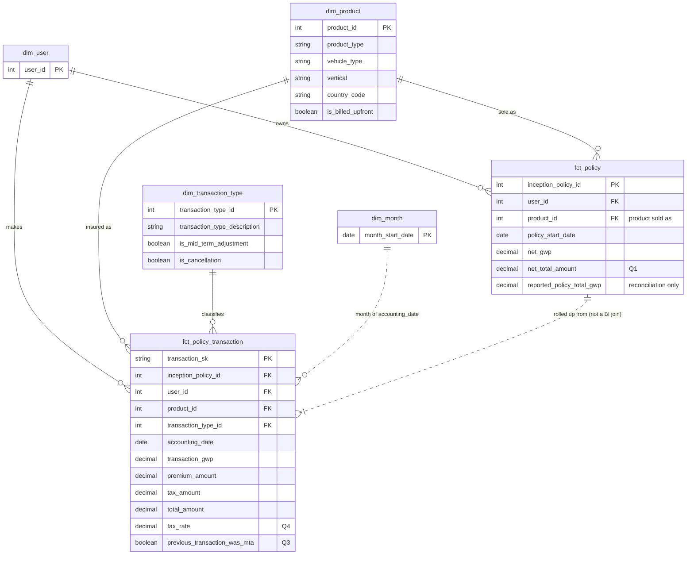

# Zego Analytics Engineering – Take-Home Task

A small dbt project that models Zego's policy transaction data into a star schema that a BI user can answer all four Part 1 questions from.

It runs end to end on hand-built sample data designed to cover every edge case in th edata dictionary: mid-term adjustments, corrections, refunds, renewals, a vehicle change mid-policy and zero-value policy. The expected answer to each question was calculated manually from that data **before** any SQL was written, and the model reproduces all of them. 40 tests run on every build. 

--- 

## 1. How to run

Requires pythonn 3.10+ and Git. Built on **DuckDB**, so there is nothing to set up: no account, credentials or server. Tested with dbt-core 1.12 and dbt-duckdb 1.11.

```bash
git clone https://github.com/Khalid-Ghzaoui/zego_ae_task.git
cd YOUR-REPO
python -m venv .venv
.venv\Scripts\activate          # Windows
# source .venv/bin/activate     # macOS / Linux
pip install dbt-duckdb

dbt deps  --profiles-dir .      # installs dbt_utils
dbt build --profiles-dir .      # loads sample data, builds 10 models, runs 40 tests
```

Run the Part 1 queries:

```bash
dbt show --select q1_fixed_policy_users            --profiles-dir .
dbt show --select q2_monthly_gwp_by_vehicle        --limit 100 --profiles-dir .
dbt show --select q3_previous_transaction_was_mta  --limit 20  --profiles-dir .
dbt show --select q4_tax_rate                      --limit 20  --profiles-dir .
```

**Project layout**

```
seeds/            sample data standing in for the four source tables
models/staging/   one model per source: types cast, JSON unpacked, keys built
models/marts/     the star schema: 4 dimensions, 2 facts
analyses/         the SQL answering Q1–Q4, written against the marts
test
```
---

## 2. Where each part of the brief is answered

| Brief | Answer |
|---|---|
| **Part 1.1, Q1:** users with ≥1 fixed policy, total value > 0 | `analyses/q1_fixed_policy_users.sql` (on `fct_policy`) |
| **Part 1.1, Q2:** monthly GWP 2025 to date by vehicle, missing months as zero | `analyses/q2_monthly_gwp_by_vehicle.sql` |
| **Part 1.1, Q3:** flag if the previous transaction was a mid-term adjustment | Column `previous_transaction_was_mta` on `fct_policy_transaction`; `analyses/q3_previous_transaction_was_mta.sql` |
| **Part 1.1, Q4:** tax rate on each transaction | Column `tax_rate` on `fct_policy_transaction`; `analyses/q4_tax_rate.sql` |
| **Part 1.2:** single data model + justification + scaling | [Section 4](#4-data-model-part-12) and `models/marts/` |
| Expected vs actual results | [Section 5](#5-results) |
| **Part 2.1:** fanout | [Section 6](#6-part-2--data-architecture--engineering-scenarios) |
| **Part 2.2:** incremental loads | [Section 6](#6-part-2--data-architecture--engineering-scenarios) |
| **Part 2.3:** data quality tests for GWP | [Section 6](#6-part-2--data-architecture--engineering-scenarios); implemented in `models/marts/_marts.yml` and `tests/` |
| **Part 3:** retention dashboard | [Section 7](#7-part-3--business-communication) |
| Assumptions | [Section 3](#3-assumptions) |

---

## 3. Assumptions

The brief asks for assumptions to be documented clearly. Each one below says what I assumed, why, and what woul dchange if it turned out to be wrong. 

### Data and keys

| # | Assumption | Why | If wrong |
|---|---|---|---|
| A1 | **The policy key is `inception_policy_id`.** It stays the same through mid-term adjustments, corrections and cancellations. A renewal creates a *new* `inception_policy_id`, with no link back to the previous policy. | The dictionary says `adjustment_policy_id` changes on mid-term adjustments, and `is_adjustment = false` generates a new `inception_policy_id`. | Policy-level results (Q1, `fct_policy`) would group transactions wrongly. The missing renewal link matters for retention (Part 3). |
| A2 | **There is no transaction key in the source.** `transaction_sk` is a hash of `inception_policy_id`, `adjustment_policy_id`, `change_number` and `transaction_type_id`, and is **tested** for uniqueness rather than assumed. | No field in the dictionary uniquely identifies a transaction. | The uniqueness test fails on build, and the key gets one more column (e.g. a date). |
| A3 | **`change_number` increases on every transaction after the first,** including corrections and cancellations, not only mid-term adjustments. | All three are `is_adjustment = true`. It is the only field that records the order of events. | Q3's ordering would need a transaction timestamp, which the source doesn't have (see Section 8). |
| A4 | **Flex is billed daily as separate policies:** each day's charge has its own `inception_policy_id`. | Flex has no term. Otherwise daily charges on one policy would be indistinguishable rows. | If daily charges share a policy id, the key in A2 needs the billing date added. |

### Business definitions

| # | Assumption | Why | If wrong |
|---|---|---|---|
| A5 | **GWP = `transaction_gwp`**, signed (refunds negative), with corrections included. | The dictionary defines it as the GWP generated by the transaction. It's tested equal to the JSON `premium`. | n/a: it's the dictionary's own definition. |
| A6 | **Accounting date** = `effective_end_date` for cancellations, `effective_start_date` otherwise. | A cancellation keeps the policy's *original* start date, so using it would put refunds in the month the policy was sold and restate history. | Refunds would land in the wrong month in Q2. **Known gap:** corrections have no date of their own, so they book to the policy start date (Section 8). |
| A7 | **"Fixed" means `product_type = 'fixed'`.** Short is a separate product type and is excluded. | The supplement lists Flex, Fixed and Short as three distinct product types, and "fixed" matches one of them exactly. | To include Short in Q1: `product_type in ('fixed', 'short')`. |
| A8 | **"Total transaction value"** = premium + tax (the JSON `total`), summed across all of a policy's transactions, net of refunds. | "Total" matches the JSON field's name, and the question's subject is the policy, so its transactions are added up first. A bought-then-fully-refunded policy correctly doesn't count. | To use GWP instead, filter on `fct_policy.net_gwp > 0` (the column already exists). Same result on the sample data. |
| A9 | **Q2 covers January 2025 to the current month,** including the partial current month, for all four vehicle types, in one currency (GBP, Delivery vertical). | "2025 to date", and Supplement 1 says the data is Delivery. | A multi-currency source would need converting before summing. |
| A10 | **GWP follows the vehicle on each transaction.** A policy whose vehicle changes mid-term reports later GWP under the new vehicle. For policy-level questions (Q1), a policy keeps the product it was **sold as**. | Written premium belongs to what was insured at the time. A policy needs one product for policy-level analysis, or Q1 would double-count it. | Only affects policies with a mid-term vehicle change. |
| A11 | **Tax rate** = tax ÷ premium, null when premium is zero. | Insurance premium tax is charged on the premium. Dividing by zero would error or mislead. | n/a. A test warns if any rate falls outside 0–20% (the UK standard and higher IPT rates). |
| A12 | **`policy_total_gwp` is never summed.** It's used only to check that our policy totals reconcile to the source. | It's a lifetime running total repeated on every row of a policy, so summing it multiplies it. | n/a. Reconciliation is tested on every build. |

### Inconsistencies in the brief

- **"Three source tables"**, but the dictionary defines **four**. `transaction_type` is
  needed for Q3 (identifying mid-term adjustments), so all four are used.
- Supplement 1 lists **four** transaction types; the dictionary lists **five**
  (adding `correction`). The model handles all five, and a test fails if any other
  value appears.

### Sample data

The brief provides no data, so `seeds/` contains hand-built rows that follow the
dictionary's structure exactly. The values are invented, and each row exists to
exercise a specific rule above: a mid-term vehicle change, a correction, a full refund,
a partial cancellation after an adjustment, a renewal, a £0 policy and a policy sold
before 2025.

---

## 4. Data model (Part 1.2)

### Diagram



### Models and their grain

| Model | One row per | Answers |
|---|---|---|
| `fct_policy_transaction` | transaction | Q2 (GWP by month and vehicle), Q3, Q4 |
| `fct_policy` | policy | Q1 |
| `dim_product` | product | Filter by product type and vehicle |
| `dim_transaction_type` | transaction type | Filter by type; flags used by the facts |
| `dim_user` | policyholder | |
| `dim_month` | calendar month | Q2's "missing months as zero" |

Staging models (`models/staging/`) sit underneath: one per source table, where types
are cast, the JSON breakdown is unpacked and `product_code` is split. They contain no
business logic, so any future model can build on them.

### Why this structure

**A star schema** keeps the numbers in facts and the descriptions in dimensions, joined
many-to-one. It's the shape BI tools like Looker are built for. Every join can only
match one row on the dimension side, so joins can't duplicate rows. That is the root
cause of fanout (Part 2.1).

**One model, two grains.** The brief asks for a single model. This is one dbt graph,
with two facts sharing the same dimensions, so filters behave the same everywhere.
There are two facts because the questions sit at two grains: Q1 asks about *policies*,
and Q2–Q4 ask about *transactions*. Forcing both into one table would mean either
repeating policy-level values on every transaction (the trap `policy_total_gwp` sets in
the source) or making every BI user re-aggregate transactions correctly by hand. The
two facts are never joined to each other in BI: `fct_policy` is *built from*
`fct_policy_transaction`, so their totals can never disagree.

**Logic lives in the model, not in queries.** The Q3 flag, the tax rate, the accounting
date and the month list are all built into the model, so any BI user gets the same
answer without re-deriving it. This is why the queries in `analyses/` are short.

**Considered and rejected:**
- **One wide table:** simpler to query, but it mixes the two grains, so policy-level
  values repeat on every transaction and get double-counted.
- **Transaction fact only:** Q1 would need every user to aggregate policies themselves,
  which is where double-counting creeps in.
- **An intermediate layer:** at this size it would add pass-through models without
  adding meaning. I'd add one as soon as logic is shared across several marts.

### How it scales

**New product types**
- A new product code (for example a new vertical, country or vehicle) is split into its
  parts automatically and appears in `dim_product`. GWP reporting picks it up with no
  code change.
- The `accepted_values` tests on `product_type` and `vehicle_type` are a **deliberate
  alarm**: they fail when an unknown value appears, so it gets reviewed and the list
  updated (one line) rather than flowing silently into reports.

**New transaction types**
- A new type is a new row in `transaction_type`. Its transactions flow into the facts
  and GWP straight away.
- Only if it needs *special handling* (like cancellations' accounting date) does it need
  one new flag in `dim_transaction_type`. The facts filter on flags, never on ids, so
  that's the only place that changes.
- The `accepted_values` test on the description flags its arrival.

**Volume**
- `fct_policy_transaction` would become incremental at production scale. See Part 2.2.
- The dimensions stay small.